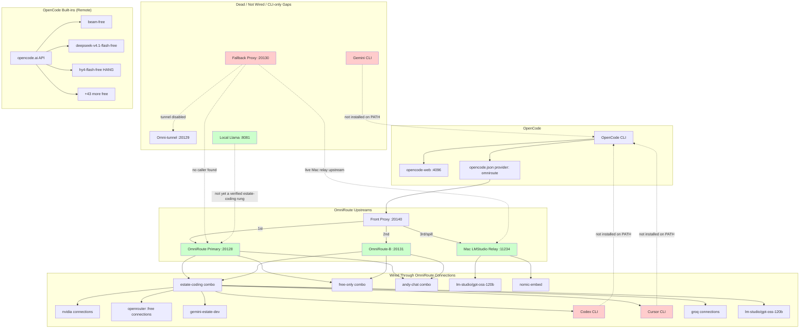

# Dell Model Stack Map (2026-11-23)

## ASCII Call Graph

```
┌─────────────────────────────────────────────────────────────────────────────┐
│                         OPENCODE (Front Door)                               │
│  ~/.opencode/bin/opencode  →  opencode-web :4096                            │
│  opencode.json provider: "omniroute" → 127.0.0.1:20140                      │
└────────────────────────────────┬────────────────────────────────────────────┘
                                 │
                                 ▼
┌─────────────────────────────────────────────────────────────────────────────┐
│                   OMNIROUTE FRONT PROXY :20140 (0.0.0.0)                    │
│  /home/andy/chapelgate/dell-services/omniroute-front-proxy.py               │
│  Health-aware, per-model semaphores, mac-spill, adaptive throttle           │
│  Injects estate OMNIROUTE_API_KEY from chapelgate-watchman.env              │
└────────────────────────────────┬────────────────────────────────────────────┘
                                 │
           ┌─────────────────────┼─────────────────────┐
           ▼                     ▼                     ▼
┌──────────────────┐  ┌──────────────────┐  ┌──────────────────┐
│ OMNIROUTE PRIMARY │  │ OMNIROUTE-B      │  │ MAC LMSTUDIO     │
│ 127.0.0.1:20128   │  │ 127.0.0.1:20131  │  │ RELAY :11234     │
│ (docker)          │  │ (docker)         │  │ (python3)        │
│ Status: 401 Auth  │  │ Status: 401 Auth │  │ Status: 200 OK   │
│ Providers:        │  │ Providers:       │  │ Models:          │
│ - estate-coding   │  │ - estate-coding  │  │ - gpt-oss-120b   │
│ - free-only       │  │ - free-only      │  │ - nomic-embed    │
│ - groq/gpt-oss    │  │ - groq/gpt-oss   │  │                  │
│ - openrouter/gpt  │  │ - openrouter/gpt │  │ Mac-spill target │
│ - cfp/gpt-oss     │  │ - cfp/gpt-oss    │  │ when all 429     │
│ - mistral/codestral│ │ - mistral/codestral│                  │
│ - local-dell-llama│  │ - local-dell-llama│                 │
└──────────────────┘  └──────────────────┘  └──────────────────┘
           │                     │                     │
           └─────────────────────┼─────────────────────┘
                                 │
                    ┌────────────┴────────────┐
                    ▼                         ▼
         ┌──────────────────┐        ┌──────────────────┐
         │ OMNIROUTE        │        │ LOCAL LLAMA      │
         │ FALLBACK :20130  │        │ 127.0.0.1:8081   │
         │ (python3)        │        │ (llama-server)   │
         │ Upstreams:       │        │ Status: 200 OK   │
         │ - 20128          │        │ Model: Qwen      │
         │ - 20129 (tunnel) │        │                  │
         │ - 11234          │        │ NOT wired to     │
         │ DEAD (no caller) │        │ OmniRoute        │
         └──────────────────┘        └──────────────────┘

┌─────────────────────────────────────────────────────────────────────────────┐
│                        MAC LANE (Separate Stack)                            │
│  Mac Studio: opencode.json + openclaw.json                                  │
│  Only local gpt-oss-120b/20b, NO OmniRoute                                  │
│  keepalive queue + mac-review.sh                                            │
│  Not behind OmniRoute, no shared skills/AGENTS.md                           │
└─────────────────────────────────────────────────────────────────────────────┘

┌─────────────────────────────────────────────────────────────────────────────┐
│                        OPCODE BUILT-IN MODELS (Remote)                      │
│  ~/.config/opencode/models.json → provider OpenCode                         │
│  api https://opencode.ai/inference/openai/v1                                │
│  ~53 free models (10 in opencode models list):                              │
│  - opencode/beam-free, big-pickle, deepseek-v4.1-flash-free,               │
│    flint-40b-free, hy4-flash-free (HUNG), iceman-free,                     │
│    mimo-v2.6-flash-free, nemotron-3.5-lightning-free,                      │
│    nemotron-3.5-super-vl-free, tidepool-alpha-free                         │
│  NOT local, third-party dependency, remote inference                        │
└─────────────────────────────────────────────────────────────────────────────┘

┌─────────────────────────────────────────────────────────────────────────────┐
│                        MISSING / NOT WIRED                                  │
│  ✗ Codex CLI: NOT installed on PATH (~/.codex dir exists only)             │
│  ✗ Gemini CLI: NOT installed on PATH                                        │
│  ✗ Cursor CLI: NOT installed on PATH                                        │
│  ✗ Local llama: NOT registered in OmniRoute (model exists but not routed)  │
│  ✗ Mac lane: NOT behind OmniRoute                                           │
│  ✗ Fallback proxy :20130: DEAD - no caller, upstreams include disabled     │
│    tunnel (20129)                                                           │
│  ✗ opencode.json has ONE provider "omniroute" - no gemini/codex/cursor     │
│    providers registered                                                     │
└─────────────────────────────────────────────────────────────────────────────┘
```

## Mermaid Diagram



## Port/Protocol/Auth Matrix

| Component | Port | Binds | Auth | Status |
|-----------|------|-------|------|--------|
| opencode-web | 4096 | 127.0.0.1 | None | ALIVE |
| Front Proxy | 20140 | 0.0.0.0 | Estate OMNIROUTE_API_KEY (injected) | ALIVE |
| OmniRoute Primary | 20128 | 127.0.0.1 | API key required | ALIVE (401 anonymous) |
| OmniRoute-B | 20131 | 127.0.0.1 | API key required | ALIVE (401 anonymous) |
| Mac LMStudio Relay | 11234 | 172.17.0.1 / 127.0.0.1 | None | ALIVE |
| Fallback Proxy | 20130 | 127.0.0.1 | Unknown | No caller found; Mac relay upstream live |
| Local Llama | 8081 | 127.0.0.1 | None | ALIVE (not yet verified combo rung) |
| caddy-local | 20180/20182 | 127.0.0.1 | None | ALIVE |
| Omni-tunnel | 20129 | - | - | DISABLED |

## OmniRoute Connection/Combo Summary

| Item | Current state | Notes |
|------|---------------|-------|
| `estate-coding` | 23 capability-ranked rungs after 24 Nov additions | codex/claude/nvidia/openrouter/gemini/groq/lm-studio; failover defect remains in storms |
| `andy-chat` | 9 rungs | codex > cursor-api > nvidia > openrouter |
| `free-only` | 10 rungs | gemini > nvidia > openrouter > groq |
| connections | 14 total, 10 active | claude inactive; mistral 402; nvidia often 429; zai active but in no combo |
| `mac-studio-lmstudio` | broken connection | returns 401 `provider_not_configured`; broken rung removed |
| `lm-studio/gpt-oss-120b` | active via 172.17.0.1:11234 | Mac rungs get almost no build traffic |
| opencode-zen | not yet a provider node | proposed first custom OpenAI-compatible provider |

## Model Registry Summary

| Model | Source | Max Concurrency | Health (last 24h) | Notes |
|-------|--------|-----------------|-------------------|-------|
| estate-coding | OmniRoute | 32 | Often healthy, but 459 storm requests had up to 15 nvidia-only attempts | Primary workhorse; failover defect |
| free-only | OmniRoute | 16 | Frequently unhealthy (probed) | Fallback |
| nvidia nemotron rungs | OmniRoute | shared account ceiling suspected | ~25-30% 200s, rest 429/503 | Do not add more nvidia models for throughput |
| openrouter :free rungs | OmniRoute | 8 | Daily free cap exhausted | Parked until cap reset/unlock |
| groq rungs | OmniRoute | 8 | org-level 429 limits | extra groq models add no lanes |
| gemini connections | OmniRoute | combo rungs | free quota often exhausted | 429-heavy |
| codex chatgpt-andy | OmniRoute | combo rungs | weekly quota exhausted until 25 Nov 07:04 UTC | CLI not installed |
| cursor-api connections | OmniRoute | combo rungs | registered | CLI not installed |
| lm-studio/gpt-oss-120b | Mac relay :11234 | combo rung | 200 in 422ms | rarely reached |
| local-dell-llama | :8081 | 8 | healthy | not yet verified final rung |
| opencode/* free models | OpenCode remote | N/A | hy4 hung 54/54; deepseek off merge-gate | Remote, third-party dependency |